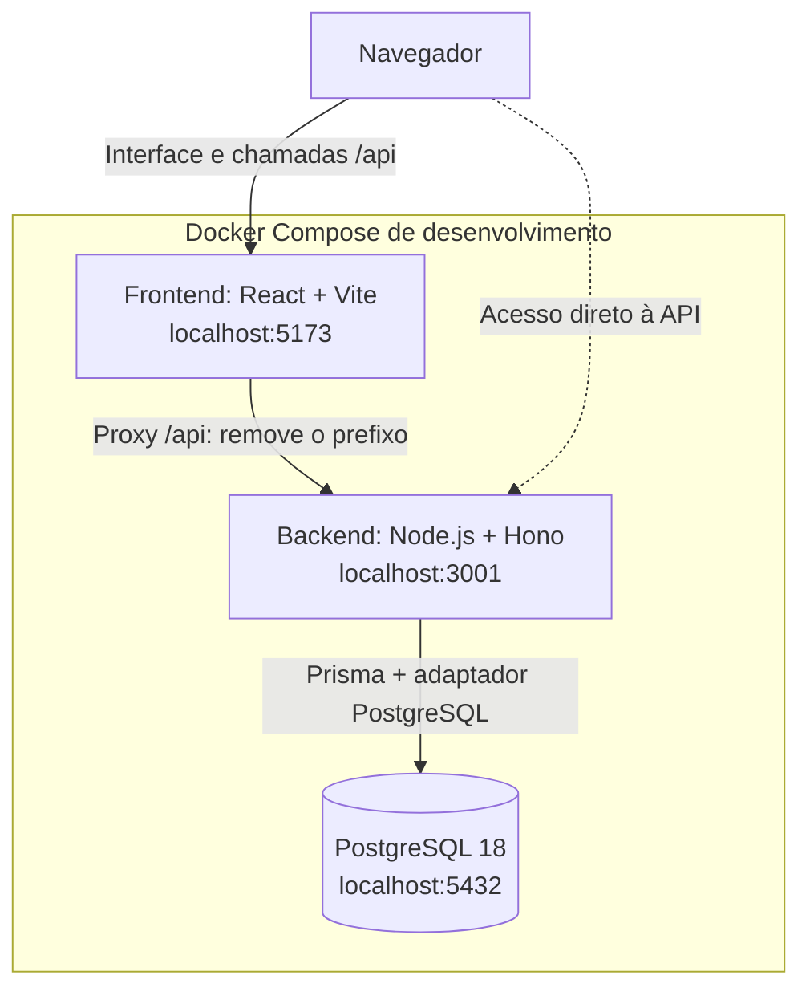
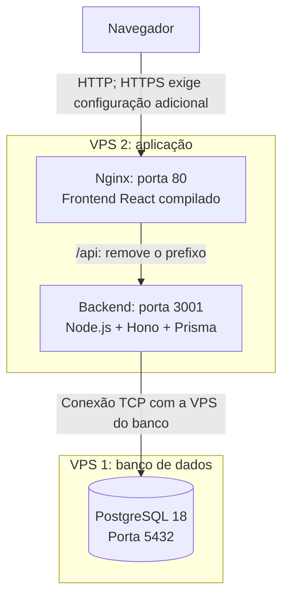
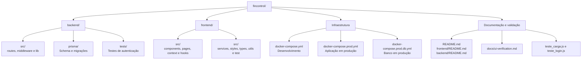

# 💰 FinControl

<div align="center">


**Sistema completo de controle financeiro pessoal com dashboards interativos**

[Início Rápido](#-início-rápido) • [Arquitetura](#-arquitetura) • [Infraestrutura](#-infraestrutura-docker) • [Documentação](#-documentação-detalhada)

</div>

---

## 📖 Sobre o Projeto

FinControl é uma aplicação web moderna e completa para gerenciamento financeiro pessoal. Desenvolvida com as melhores práticas de desenvolvimento, oferece uma interface intuitiva para controle de receitas, despesas, parcelamentos, transações recorrentes e visualização de dados através de dashboards interativos com gráficos e relatórios.

### ✨ Principais Funcionalidades

- 🔐 **Autenticação JWT** - Sistema seguro de login e registro
- 💰 **Gestão de Transações** - Central de lançamentos com receitas e despesas fixas e variáveis
- 🔄 **Transações Recorrentes** - Configure contas fixas mensais
- 📊 **Dashboard Personalizável** - Saldo, planejamento mensal e sete módulos reorganizáveis, com gráficos e valores consultáveis
- 🏷️ **Categorias Personalizadas** - Organize suas finanças do seu jeito
- 📅 **Calendário Financeiro** - Veja suas transações em formato de calendário
- 💳 **Parcelamentos** - Gerencie compras parceladas
- 🌓 **Tema Claro/Escuro** - Segue o sistema até a escolha manual, com preferência persistida no navegador
- 📈 **Relatórios** - Resumo mensal e históricos de receitas e despesas em abas
- 💰 **Planejamento de Investimento** - Valor mensal padrão e ajustes por mês, persistidos por usuário no banco
- 📱 **Interface Responsiva** - Barra lateral no desktop, navegação inferior no celular e lançamento rápido
- 🎓 **Tutorial Guiado Interativo** - Onboarding automático para novos usuários com Driver.js

---

## 🏗️ Arquitetura

O projeto segue uma arquitetura moderna de aplicação web full-stack:

### Desenvolvimento (Local)


### Produção (2 VPS)


**Arquitetura de Produção:**
- **VPS 1:** Banco de dados PostgreSQL dedicado
- **VPS 2:** Frontend (Nginx) + Backend (Node.js)
- **Comunicação:** Backend se conecta ao PostgreSQL via IP/hostname da VPS 1

### 📦 Stack Tecnológico

#### Frontend
| Tecnologia | Descrição |
|-----------|-----------|
|  | Biblioteca JavaScript para interfaces |
|  | Superset tipado do JavaScript |
|  | Build tool ultrarrápido |
|  | Framework CSS utility-first |
|  | Roteamento declarativo |
|  | Gerenciamento de estado assíncrono |
|  | Biblioteca de gráficos em React |
|  | Cliente HTTP |
|  | Ícones modernos |
|  | Organização dos módulos do dashboard |
| Radix UI Dialog | Modais e painéis com gerenciamento de foco |
| Driver.js | Tutorial guiado |
| Vitest + Testing Library + jsdom | Testes de componentes, hooks e interação |

#### Backend
| Tecnologia | Descrição |
|-----------|-----------|
|  | Runtime JavaScript server-side |
|  | Superset tipado do JavaScript |
|  | Framework web ultrarrápido |
|  | ORM moderno para Node.js |
|  | Banco de dados relacional |
|  | Validação de schemas TypeScript |
|  | Autenticação stateless |

#### Infraestrutura
| Tecnologia | Descrição |
|-----------|-----------|
|  | Containerização da aplicação |
|  | Servidor web e proxy reverso |
|  | Testes de carga e performance |

📚 **Documentação detalhada:**
- [Frontend README](./frontend/README.md) - Componentes, arquitetura e desenvolvimento
- [Backend README](./backend/README.md) - API, endpoints e banco de dados

---

## 🚀 Início Rápido

### Pré-requisitos

- [Docker](https://docs.docker.com/get-docker/) 20.10+
- [Docker Compose](https://docs.docker.com/compose/install/) 2.0+
- [Git](https://git-scm.com/downloads)

### Instalação em 3 Passos

1️⃣ **Clone o repositório**
```bash
git clone https://github.com/lukagouvea/fincontrol.git
cd fincontrol
```

2️⃣ **Configure as variáveis de ambiente**
```bash
# Crie o arquivo usado pelo docker-compose de desenvolvimento
cp .env.dev.example .env.dev

# (Opcional) Prepare também o arquivo de produção
cp .env.prod.example .env.prod

# Se precisar rodar backend/frontend fora do Docker, gere os envs locais
cp backend/.env.example backend/.env
cp frontend/.env.example frontend/.env
```

> 💡 **Dica rápida:** mantenha `POSTGRES_HOST=db` no `.env.dev` (os containers se enxergam pelo nome do serviço) e configure um host/IP real no `.env.prod` quando o PostgreSQL estiver fora do Docker.

> 📝 **Veja os READMEs específicos para detalhes adicionais:**
> - [Configuração do Backend](./backend/README.md#variáveis-de-ambiente)
> - [Configuração do Frontend](./frontend/README.md#variáveis-de-ambiente)

3️⃣ **Execute com Docker**
```bash
docker compose --env-file .env.dev up --build
```

Na primeira execução, aplique as migrações em outro terminal, com o banco e o backend ativos:

```bash
docker compose --env-file .env.dev exec backend npx prisma migrate deploy
```

O container de desenvolvimento gera o cliente Prisma ao iniciar, mas não aplica as migrações automaticamente.

✅ **Pronto!** Acesse:
- 🌐 Frontend: http://localhost:5173
- 🔌 Backend API: http://localhost:3001

---

## 🐳 Infraestrutura Docker

### Arquivos de Composição

O projeto possui três arquivos Docker Compose:

| Arquivo | Ambiente | Uso |
|---------|----------|-----|
| `docker-compose.yml` | **Desenvolvimento** | Hot reload, logs detalhados |
| `docker-compose.prod.yml` | **Produção: aplicação** | Imagens publicadas de backend e frontend com Nginx |
| `docker-compose.prod.db.yml` | **Produção: banco** | PostgreSQL dedicado |

### Arquivos de Ambiente

Cada arquivo `docker-compose` utiliza um arquivo `.env` dedicado para centralizar as variáveis compartilhadas entre os serviços:

| Arquivo | Finalidade | Como usar |
|---------|------------|-----------|
| `.env.dev` | Valores padrão para desenvolvimento local (credenciais do PostgreSQL, porta da API, URLs) | `docker compose --env-file .env.dev ...` |
| `.env.prod` | Configurações sensíveis e URLs públicas usadas no deploy | `docker compose --env-file .env.prod -f docker-compose.prod.yml ...` |

> 📁 Os exemplos `.env.dev.example` e `.env.prod.example` servem como base para criar seus arquivos reais (que permanecem ignorados pelo Git).
>
> 🔐 **Produção:** defina `POSTGRES_HOST` apontando para o banco externo (IP da VPS, serviço gerenciado, etc). No dev continue usando `db`, que é o hostname interno do container PostgreSQL.

### Modo Desenvolvimento

Ideal para desenvolvimento local com **hot reload** automático (carrega as variáveis de `.env.dev`):

```bash
docker compose --env-file .env.dev up --build
```

**Recursos:**
- ✅ Hot reload no frontend (Vite)
- ✅ Hot reload no backend (tsx watch)
- ✅ Volumes montados para edição em tempo real
- ✅ Logs detalhados no console
- ✅ Porta 5173 (frontend) e 3001 (backend) expostas

**Portas:**
- Frontend: http://localhost:5173
- Backend: http://localhost:3001
- PostgreSQL: localhost:5432

### Modo Produção

Ambiente otimizado para deploy em servidores com arquitetura de 2 VPS.

#### 🚀 Deploy com GitHub Actions

O workflow [`.github/workflows/deploy.yml`](./.github/workflows/deploy.yml) constrói as imagens em pull requests para `main`. Em pushes para `main`, publica as imagens no Docker Hub e atualiza a VPS da aplicação por SSH.

Configure os secrets `DOCKER_USERNAME`, `DOCKER_PASSWORD`, `VPS_HOST`, `VPS_USER` e `VPS_KEY`. O Compose de produção aponta para imagens de `lukagouvea`; ajuste esse namespace se publicar em outra conta.

O workflow copia somente o Compose da aplicação, renomeia-o para `docker-compose.yml` no servidor e executa `docker compose pull` e `docker compose up -d`. Prepare previamente o banco e um `.env` no diretório remoto com os valores de produção: o workflow não envia variáveis nem usa `--env-file .env.prod`.

#### 🔧 Deploy Manual

**Na VPS 1 (Banco de Dados):**

```bash
# Configure .env.prod a partir de .env.prod.example
docker compose --env-file .env.prod -f docker-compose.prod.db.yml up -d
docker compose --env-file .env.prod -f docker-compose.prod.db.yml logs -f db
```

**Na VPS 2 (Frontend + Backend):**

Configure `.env.prod` com `POSTGRES_HOST` apontando para a VPS do banco e aguarde o PostgreSQL aceitar conexões.

```bash
docker compose --env-file .env.prod -f docker-compose.prod.yml pull
docker compose --env-file .env.prod -f docker-compose.prod.yml up -d
```

O backend executa `prisma migrate deploy` antes de iniciar a versão compilada. O Compose de produção usa imagens publicadas; ele não compila as alterações locais da branch. Para construir imagens locais, consulte os READMEs do [frontend](./frontend/README.md) e do [backend](./backend/README.md).

O Nginx encaminha `/api/` para `backend:3001` e remove o prefixo. Mantenha `BACKEND_PORT=3001` ou ajuste também o proxy. `VITE_API_URL` é definido no build da imagem frontend; alterar apenas o `.env.prod` não modifica uma imagem já compilada.

**Otimizações:**
- ✅ Build minificado e otimizado
- ✅ Nginx como servidor web de alta performance
- ✅ Banco de dados isolado em VPS dedicada
- ✅ Containers em modo detached
- ✅ Healthcheck do PostgreSQL no Compose do banco

**Portas:**
- Aplicação completa: http://localhost (porta 80; HTTPS exige configuração adicional)
- API acessível em: http://localhost/api
- PostgreSQL (VPS 1): Port 5432

### Comandos Docker Úteis

Os comandos abaixo usam o Compose de desenvolvimento. Para produção manual, acrescente `--env-file .env.prod -f docker-compose.prod.yml` antes do subcomando.

```bash
# Ver status dos containers
docker compose --env-file .env.dev ps

# Ver logs em tempo real
docker compose --env-file .env.dev logs -f

# Ver logs de um serviço específico
docker compose --env-file .env.dev logs -f backend

# Parar containers
docker compose --env-file .env.dev down

# Parar e remover volumes (⚠️ apaga dados do banco)
docker compose --env-file .env.dev down -v

# Rebuild de um serviço específico
docker compose --env-file .env.dev up --build backend

# Acessar shell do container
docker compose --env-file .env.dev exec backend sh

# Executar migrações do Prisma
docker compose --env-file .env.dev exec backend npx prisma migrate deploy

# Reiniciar um serviço
docker compose --env-file .env.dev restart frontend
```

### Volumes e Persistência

**Desenvolvimento:**
```yaml
volumes:
  - ./backend:/app          # Código do backend (hot reload)
  - ./frontend:/app         # Código do frontend (hot reload)
  - /app/node_modules       # Protege dependências
  - fincontrol-data-dev     # Dados do PostgreSQL
```

**Produção:**
```yaml
volumes:
  - fincontrol-data-prod    # Dados do PostgreSQL persistidos
```

### Segurança em Produção

**Checklist antes de fazer deploy:**

- ✅ Altere todas as senhas padrão (`POSTGRES_PASSWORD`, etc)
- ✅ Gere um `JWT_SECRET` forte (mínimo 32 caracteres aleatórios)
- ✅ Configure HTTPS com certificados SSL (recomendado: Let's Encrypt)
- ✅ Configure firewall para expor apenas portas necessárias (80, 443)
- ✅ Implemente rate limiting no Nginx
- ✅ Configure backups automáticos do banco de dados
- ✅ Monitore logs de acesso e erros
- ✅ Mantenha os containers atualizados

---

## 🧪 Verificações de Desenvolvimento

```bash
# Frontend
cd frontend
npm run test
npm run typecheck
npm run build

# Backend (com .env configurado e cliente Prisma gerado)
cd ../backend
npm test
npm run build
```

Os testes do frontend usam Vitest, Testing Library e jsdom para cobrir navegação, formulários, calendário, relatórios, investimento e tema. Os testes do backend verificam autenticação por cookie e JWT HS256, com acesso ao Prisma substituído nos testes.

A matriz de inspeção visual e suas pendências estão em [docs/ui-verification.md](./docs/ui-verification.md).

## 🧪 Testes de Carga

O projeto inclui scripts de teste de performance usando [k6](https://k6.io/), ferramenta open-source da Grafana Labs.

### Instalação do k6

**Linux:**
```bash
sudo gpg -k
sudo gpg --no-default-keyring --keyring /usr/share/keyrings/k6-archive-keyring.gpg \
  --keyserver hkp://keyserver.ubuntu.com:80 \
  --recv-keys C5AD17C747E3415A3642D57D77C6C491D6AC1D69
echo "deb [signed-by=/usr/share/keyrings/k6-archive-keyring.gpg] https://dl.k6.io/deb stable main" | \
  sudo tee /etc/apt/sources.list.d/k6.list
sudo apt-get update
sudo apt-get install k6
```

**MacOS:**
```bash
brew install k6
```

**Docker:**
```bash
docker pull grafana/k6
```

Antes de executar, ajuste as URLs fixas e as credenciais nos scripts para o ambiente que deseja testar.

### Scripts Disponíveis

#### 📈 Teste de Carga Geral
```bash
k6 run teste_carga.js
# ou com Docker
docker run --rm -i grafana/k6 run - < teste_carga.js
```
Sobe até 50 usuários em 30 segundos, mantém a carga por 1 minuto e reduz a zero em 10 segundos.

#### 🔐 Teste de Estresse de Login
```bash
k6 run teste_login.js
# ou com Docker
docker run --rm -i grafana/k6 run - < teste_login.js
```
Sobe até 20 usuários em 30 segundos. O script aceita respostas 200 e 401; o Nginx também pode retornar 429 por limite de tentativas.

---

## 📚 Documentação Detalhada

### Documentação por Módulo

Para informações mais detalhadas sobre cada parte do projeto:

📘 **[Backend Documentation](./backend/README.md)**
- Arquitetura da API
- Endpoints detalhados com exemplos
- Modelo de dados e relacionamentos
- Configuração do Prisma
- Autenticação e segurança
- Como desenvolver novas features

📗 **[Frontend Documentation](./frontend/README.md)**
- Arquitetura de componentes
- Estrutura de páginas e rotas
- Context API e gerenciamento de estado
- Custom hooks
- Estilização e temas
- Como adicionar novos componentes

### Estrutura de Pastas



---

## 🤝 Contribuindo

Contribuições são bem-vindas! Para contribuir:

1. Fork o projeto
2. Crie uma branch para sua feature (`git checkout -b feature/NovaFuncionalidade`)
3. Commit suas mudanças (`git commit -m 'Adiciona nova funcionalidade'`)
4. Push para a branch (`git push origin feature/NovaFuncionalidade`)
5. Abra um Pull Request
