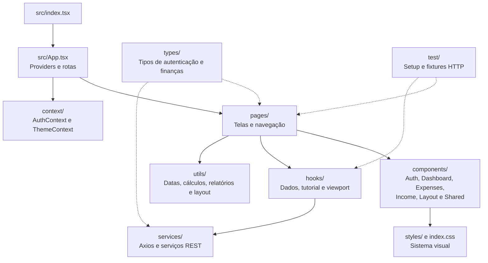
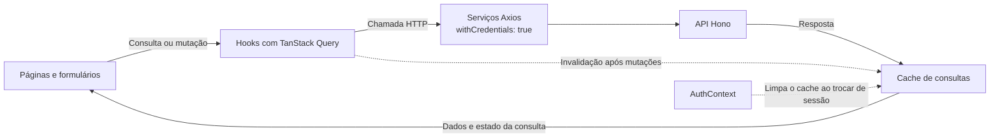

# 🎨 FinControl Frontend

Interface de controle financeiro pessoal com React, TypeScript e Tailwind CSS.

## Funcionalidades

- **Início:** saldo, receitas, despesas e orçamento planejado. O planejamento reserva despesas fixas, parcelas e investimento antes dos gastos variáveis, com referências diária e semanal.
- **Dashboard personalizável:** sete módulos — Contas do mês, Despesas recentes, Sua semana, Gastos por categoria, Gastos nos últimos 7 dias, Distribuição dos gastos e Evolução do saldo mensal. A organização permite arrastar ou usar controles de posição e é salva em `localStorage` na chave `dashboardLayout`.
- **Lançamentos:** receitas e despesas fixas e variáveis na mesma central, com criação, edição, parcelamentos, variações mensais e consulta de recorrências encerradas.
- **Relatórios:** abas de resumo mensal, despesas e receitas, com seleção de período e agrupamento por categoria.
- **Calendário:** grade mensal e agenda do dia, navegação entre meses, ação Hoje e lançamento com a data selecionada. As consultas antecipam meses vizinhos no cache.
- **Categorias:** nome, descrição, cor e tipo. A exclusão desativa a categoria, preservando os vínculos históricos.
- **Conta:** investimento mensal padrão com salvamento explícito, tema, tutorial e saída. O investimento também aceita um valor específico por mês nos relatórios.
- **Layout responsivo:** barra lateral no desktop e navegação inferior com menu Mais no celular. O botão Novo lançamento abre o formulário rápido.

## Tecnologias

As versões e faixas de dependências estão em [package.json](./package.json); o [package-lock.json](./package-lock.json) fixa as versões instaladas por `npm ci`.

| Tecnologia | Uso |
|---|---|
| React 18 + TypeScript | Componentes e tipagem |
| Vite 7 | Desenvolvimento e build |
| Tailwind CSS 3 + CSS próprio | Estilização e tokens visuais |
| React Router 6 | Rotas e parâmetros de navegação |
| TanStack Query 5 + Axios | Consultas, mutações, cache e HTTP |
| Recharts + DND Kit | Gráficos e organização do dashboard |
| Radix UI Dialog | Modais e painéis com gerenciamento de foco |
| Driver.js | Tutorial guiado |
| Public Sans + Lucide | Fonte local e ícones |
| Vitest + Testing Library + jsdom | Testes automatizados |

## Desenvolvimento local

Use Node.js 22.12+ da linha 22 e npm, alinhados à imagem `node:22-alpine` do Dockerfile. Execute os comandos a partir de `frontend/`:

```bash
npm ci
cp .env.example .env
```

Para executar frontend e backend diretamente na máquina, configure:

```dotenv
VITE_API_URL=http://localhost:3001
```

Inicie o backend com `FRONTEND_URL=http://localhost:5173` e depois execute:

```bash
npm run dev
```

Acesse http://localhost:5173. O [README do backend](../backend/README.md) descreve a configuração do banco e as migrações.

### Variáveis de ambiente

| Variável | Uso |
|---|---|
| `VITE_API_URL` | Base das chamadas HTTP. O exemplo usa `/api`, apropriado para os proxies Docker. |

O proxy de [vite.config.ts](./vite.config.ts) encaminha `/api` para `http://backend:3001` e remove o prefixo. Esse hostname pertence à rede do Compose. Para rodar fora dela, use a URL absoluta acima ou adapte o proxy para `http://localhost:3001`.

As variáveis `VITE_*` são incorporadas ao build. Alterá-las exige recompilar o frontend.

### Scripts

```bash
npm run dev        # Vite com hot reload
npm run test       # Vitest em execução única
npm run typecheck  # TypeScript sem emitir arquivos
npm run build      # Build Vite em dist/
npm run preview    # Visualização do build
npm run lint       # Executar ESLint
```

`npm run build` não executa a checagem de tipos; use também `npm run typecheck`. A suíte cobre navegação, formulários, calendário, relatórios, investimento, conta, tema e cálculos financeiros. O ambiente e as fixtures ficam em `src/test/`.

A inspeção visual tem uma matriz própria e pendências registradas em [docs/ui-verification.md](../docs/ui-verification.md).

## Rotas

As rotas ativas são definidas em [src/App.tsx](./src/App.tsx), que também configura os providers e o carregamento de páginas sob demanda.

| Caminho | Conteúdo |
|---|---|
| `/login` | Entrada |
| `/signup` | Cadastro |
| `/` | Início e dashboard |
| `/lancamentos` | Central de receitas e despesas |
| `/calendario` | Calendário e agenda |
| `/relatorio-mensal` | Relatórios em abas |
| `/categorias` | Gestão de categorias |

As páginas financeiras exigem sessão. Endereços desconhecidos exibem uma página 404.

Em `/lancamentos`, `tipo=receita` ou `tipo=despesa` e `grupo=fixas` ou `grupo=variaveis` selecionam as listas. Em `/relatorio-mensal`, `aba=resumo`, `aba=despesas` ou `aba=receitas` seleciona o relatório.

Os endereços anteriores `/despesas-variaveis`, `/despesas-fixas`, `/rendas-variaveis` e `/rendas-fixas` redirecionam para a central com os filtros correspondentes. `/historico-despesas` e `/historico-rendas` redirecionam para as abas de relatórios.

## Estrutura e estado



- **AuthContext:** restaura a sessão via `/auth/me`, gerencia entrada/saída e limpa o cache ao trocar de sessão. O JWT fica no cookie HttpOnly `auth_token`; o Axios usa `withCredentials: true`.
- **ThemeContext:** usa a preferência válida `light` ou `dark` salva em `localStorage.theme`. Sem preferência, acompanha `prefers-color-scheme`, inclusive mudanças do sistema. Ao alternar manualmente pela conta, salva a escolha e passa a usá-la. A troca continua funcionando quando o armazenamento está indisponível. O provider atualiza as classes da raiz e a meta `theme-color`.
- **TanStack Query:** gerencia os dados financeiros. O investimento inclui usuário e versão de sessão nas chaves de cache para isolar respostas entre contas. `FinanceContext.tsx` permanece no código, mas não está montado na árvore atual de providers.
- **TutorialProvider:** conduz o tutorial com Driver.js e persiste a conclusão por usuário pela API. A conta permite revê-lo.
- **Sistema visual:** `src/styles/system.css`, `src/index.css` e `tailwind.config.js` definem os estilos. Componentes compartilhados incluem estados de carregamento, erro, vazio e diálogos.

### Fluxo dos dados financeiros



O saldo usa receitas menos despesas. O planejamento do dashboard desconta compromissos e investimento para estimar o orçamento disponível. `utils/reportData.ts` combina valores fixos e variáveis sem contar novamente as transações usadas como variações de recorrências.

## Docker e Nginx

A partir da raiz do repositório, após preparar `.env.dev`:

```bash
docker compose --env-file .env.dev up --build
# Em outro terminal, na primeira execução:
docker compose --env-file .env.dev exec backend npx prisma migrate deploy
```

Para construir somente a imagem de produção, a partir de `frontend/`:

```bash
docker build --target runner --build-arg VITE_API_URL=/api -t fincontrol-frontend:local .
```

O estágio `runner` serve `dist/` com Nginx. O Compose de produção usa imagens publicadas; consulte o [README principal](../README.md) para deploy.

O [nginx.conf](./nginx.conf) atende as rotas da SPA com `index.html`, encaminha `/api/` para `backend:3001` e limita tentativas de login. O HTML exige revalidação de cache; arquivos estáticos têm cache de um ano. Isso permite que novos acessos obtenham o HTML do deploy atual.

## Contribuindo

Adicione novas rotas em `src/App.tsx` e itens de navegação em `components/Layout/Sidebar.tsx`. Reutilize os componentes de `Shared/` e os serviços HTTP existentes. Valide as mudanças com os scripts adequados e a matriz visual.

[Voltar ao README principal](../README.md)
